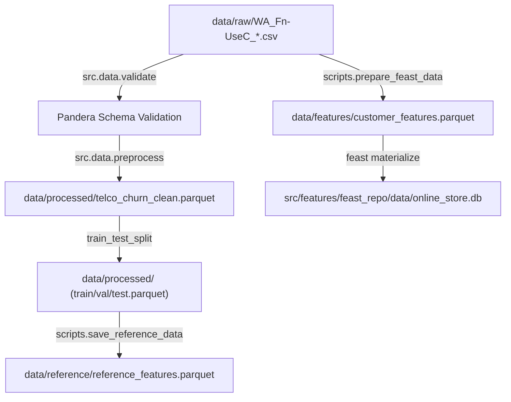

# Data Architecture & Storage Taxonomy

This directory implements a four-tier data storage taxonomy for reproducible data engineering and model operations.

---

## 1. Directory Structure

```
data/
├── raw/                         # Tier 1: Immutable raw source files (versioned by DVC)
│   ├── WA_Fn-UseC_-Telco-Customer-Churn.csv
│   └── WA_Fn-UseC_-Telco-Customer-Churn.csv.dvc
├── processed/                   # Tier 2: Canonical preprocessed datasets & train/val/test splits
│   ├── telco_churn_clean.parquet
│   ├── train.parquet
│   ├── val.parquet
│   └── test.parquet
├── features/                    # Tier 3: Feast feature store offline storage
│   └── customer_features.parquet
└── reference/                   # Tier 4: Production drift monitoring reference baselines
    ├── reference_features.parquet
    └── reference_metadata.json
```

---

## 2. Storage Tier Definitions & Responsibilities

### Tier 1: Raw Data (`data/raw/`)
- **Immutability Principle**: Raw files are strictly read-only. No transformation or script ever modifies files in `data/raw/`.
- **Version Control**: Tracked via **DVC** (`.dvc` pointer files committed to Git; binary datasets stored in remote storage or DagsHub S3-compatible backend).
- **Contents**:
  - `WA_Fn-UseC_-Telco-Customer-Churn.csv`: The canonical 7,043-row telecommunications subscriber record dataset.

### Tier 2: Processed Data (`data/processed/`)
- **Responsibility**: Cleaned, validated, and partitioned datasets prepared for modeling.
- **Transformations Applied**:
  - Target variable binarization (`Churn: Yes/No` $\rightarrow$ `1/0`).
  - Casting categorical types (e.g., `SeniorCitizen` cast to string category).
  - PII removal (`customerID` dropped to avoid identity leakage).
  - TotalCharges whitespace imputation with `MonthlyCharges`.
- **Format**: Apache Parquet (`.parquet`) using Snappy compression for 85% storage savings and sub-second I/O.
- **Partitions**:
  - `telco_churn_clean.parquet`: Full cleaned dataset (7,043 rows, 20 columns).
  - `train.parquet`: Stratified training partition (60%, ~4,225 rows).
  - `val.parquet`: Stratified validation partition for calibration & threshold tuning (20%, ~1,409 rows).
  - `test.parquet`: Stratified held-out test partition for final audit (20%, ~1,409 rows).

### Tier 3: Feature Store Offline Storage (`data/features/`)
- **Responsibility**: Feast feature store offline source.
- **Structure**:
  - Includes primary entity keys (`customerID`) and point-in-time join timestamps (`event_timestamp`).
  - Contains all 19 raw schema features and event metadata.
  - Used by Feast CLI (`feast apply`, `feast materialize-incremental`) to sync feature definitions to the SQLite online store (`src/features/feast_repo/data/online_store.db`).

### Tier 4: Drift Reference Baselines (`data/reference/`)
- **Responsibility**: Baseline distribution snapshot used for real-time drift detection (Population Stability Index, Kolmogorov-Smirnov, Chi-square tests).
- **Generated By**: `poetry run python scripts/save_reference_data.py` (or `make save-reference`).
- **Files**:
  - `reference_features.parquet`: 7,043 rows $\times$ 47 engineered features.
  - `reference_metadata.json`: Feature count, data types, and generation timestamp.

---

## 3. Data Lineage & Pipeline Flow



---

## 4. How to Reproduce All Data Tiers

```bash
# 1. Pull raw data via DVC
poetry run dvc pull

# 2. Build Feast offline features
poetry run python scripts/prepare_feast_data.py

# 3. Apply Feast feature definitions & materialize online store
make feast-apply
make feast-materialize

# 4. Generate drift reference snapshot
poetry run python scripts/save_reference_data.py
```
