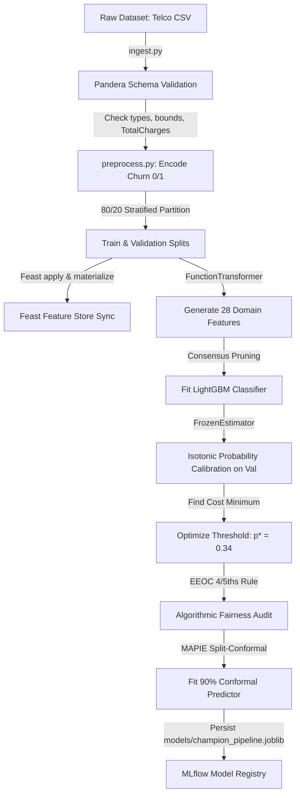
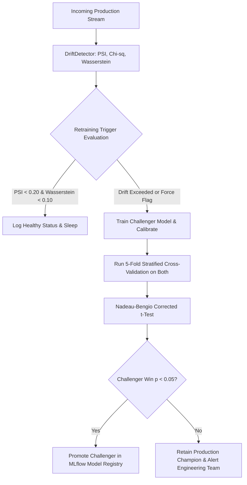
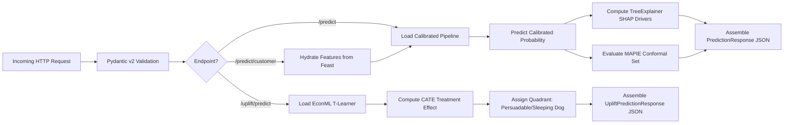

# System Architecture Guide

Comprehensive architectural documentation for the **Customer Churn MLOps & Causal AI Platform**.

---

## 1. Architectural Philosophy & Principles

The system is designed according to core MLOps engineering principles:

1. **Decoupled Production Workflows**: Research notebooks are strictly exploratory artifacts; all production pipelines (ingestion, validation, training, calibration, drift monitoring, retraining) run through orchestrated Prefect flows outside notebooks.
2. **Strict Training-Serving Parity**: The Scikit-Learn `Pipeline` encapsulates feature engineering (28 domain functions), preprocessing, and calibrated inference into a single serialized object, making training-serving skew structurally impossible.
3. **Stateless Feature Engineering**: All feature transformations are pure, stateless functions that execute identically on a single production inference row or a million-row batch.
4. **Economic Optimization over Symmetric Metrics**: The decision threshold ($p^* = 0.34$) is derived from an asymmetric business cost matrix ($C_{FN} = \$500$ vs $C_{FP} = \$50$), directly maximizing net revenue saved.
5. **Prescriptive Actionability via Causal AI**: Moving beyond predictive risk scoring ($P(Y=1 \mid X)$) to isolate the Conditional Average Treatment Effect (CATE) via an EconML T-Learner, preventing wasted spend on *Sure Things* and suppression of *Sleeping Dogs*.
6. **Statistical Rigor in Retraining Gates**: Model promotion is protected by the **Nadeau-Bengio (2003) corrected repeated k-fold t-test**, eliminating anti-conservative false positives caused by shared CV fold data.
7. **Distribution-Free Uncertainty Bounds**: Incorporating **MAPIE Split-Conformal Prediction** to output 90% confidence prediction sets alongside point probabilities.

---

## 2. High-Level System Architecture

```
┌───────────────────────────────────────────────────────────────────────────────────┐
│                             PRESENTATION & CONSUMERS                              │
│  FastAPI Swagger (port 8000) │ Streamlit (port 8501) │ Grafana Telemetry (3000)   │
└─────────────────────────────────────────┬─────────────────────────────────────────┘
                                          │
┌─────────────────────────────────────────▼─────────────────────────────────────────┐
│                                 SERVING LAYER                                     │
│  api.py (REST /api/v1) │ schemas.py (Pydantic v2) │ model_loader.py (Thread Cache)│
│  ├── /api/v1/predict & /predict/batch (LightGBM + SHAP + MAPIE Conformal Sets)    │
│  ├── /api/v1/predict/batch/async (Non-blocking async worker jobs + polling)       │
│  ├── /api/v1/predict/customer/{id} (Feast Online Store SQLite/Redis Hydration)    │
│  ├── /api/v1/uplift/predict & batch (EconML T-Learner CATE Quadrant Engine)       │
│  ├── OWASP Security Headers (nosniff, DENY, HSTS, CSP) & Sliding-Window Rate Limit│
│  └── Decoupled Probes: /health (Liveness) & /readiness (Model Artifact Readiness) │
└─────────────────────────────────────────┬─────────────────────────────────────────┘
                                          │
┌─────────────────────────────────────────▼─────────────────────────────────────────┐
│                     ORCHESTRATED PRODUCTION PIPELINES (pipelines/)                │
│  training_pipeline.py                   │  retraining_pipeline.py                 │
│  ├── Ingest & Pandera Schema Validation │  ├── Decile PSI & Chi-sq Drift Check    │
│  ├── Feast Feature Store Materialize    │  ├── Challenger Training & Calibration  │
│  ├── 47-Feature Pipeline Fit            │  ├── Nadeau-Bengio Corrected t-Test Gate│
│  ├── Isotonic FrozenEstimator Calibrate │  └── MLflow Registry Champion Promotion │
│  ├── EEOC 4/5ths Rule Fairness Audit    │                                         │
│  └── MAPIE Conformal Artifact Persist   │                                         │
└─────────────────────────────────────────┬─────────────────────────────────────────┘
                                          │
┌─────────────────────────────────────────▼─────────────────────────────────────────┐
│                       CORE DATA SCIENCE MODULES (src/)                            │
│  src/data/      : ingest.py, validate.py (Pandera), preprocess.py                 │
│  src/features/  : feature_store.py (28 features), feature_selector.py, feast_repo  │
│  src/models/    : train.py, pipeline.py, threshold.py, conformal.py, uplift.py,   │
│                   fairness_audit.py, statistical_comparison.py                    │
│  src/monitoring/: drift_detector.py, reference_builder.py                         │
│  src/utils/     : config_loader.py (Singleton YAML Dataclasses), logging.py       │
│  src/serving/   : api.py (API v1, RateLimiting), schemas.py, model_loader.py      │
└─────────────────────────────────────────┬─────────────────────────────────────────┘
                                          │
┌─────────────────────────────────────────▼─────────────────────────────────────────┐
│                       INFRASTRUCTURE & EXTERNAL SERVICES                          │
│  MLflow (5000) │ Prometheus (9090) │ Kubernetes (Kustomize) │ Docker │ GitHub CI  │
└───────────────────────────────────────────────────────────────────────────────────┘
```

---

## 3. Module Dependency Graph

```
src/utils/config_loader.py   (Loads YAML configs into typed dataclasses)
src/utils/logging.py          (Structured JSON/text logging across processes)
         │
         ▼
src/data/ingest.py           (Raw CSV loader & train/test partitioning)
src/data/validate.py         (Pandera schema validation contracts)
src/data/preprocess.py       (Target encoding & SeniorCitizen casting)
         │
         ▼
src/features/feature_store.py (28 domain features; Feast feature views)
src/features/feature_selector.py (5-stage consensus feature pruning)
         │
         ▼
src/models/pipeline.py       (sklearn.Pipeline assembler: FeatEng → Prep → Clf)
src/models/threshold.py      (Cost-optimal threshold optimization)
src/models/conformal.py      (MAPIE split-conformal wrapper)
src/models/uplift.py         (EconML T-Learner CATE model)
src/models/fairness_audit.py (EEOC 4/5ths Disparate Impact audit)
src/models/statistical_comparison.py (Nadeau-Bengio corrected CV t-test)
         │
         ▼
pipelines/training_pipeline.py   (Automated production training Prefect flow)
pipelines/retraining_pipeline.py (Automated drift-triggered retraining flow)
         │
         ▼
src/serving/schemas.py       (Pydantic v2 input/output data validation)
src/serving/model_loader.py  (Lazy thread-safe caching with instant disk fallback)
src/serving/api.py           (FastAPI serving routes & Prometheus counters)
```

---

## 4. End-to-End Pipeline Data Flows

### A. Production Training Flow (`pipelines/training_pipeline.py`)



### B. Production Retraining Flow (`pipelines/retraining_pipeline.py`)



### C. Real-Time Serving Flow (`src/serving/api.py`)



---

## 5. In-Depth Engineering Decisions

### 1. Training-Serving Parity via `sklearn.Pipeline`
**Decision:** All 28 domain features, ColumnTransformer scalers, OneHotEncoders, and classifier steps are encapsulated into a single unified `sklearn.Pipeline`.
**Why:** Prevents a common failure mode in deployed ML systems: training-serving skew. At inference time, the exact identical code path and fitted parameters run on incoming production rows.

### 2. Isotonic Calibration with Modern `FrozenEstimator`
**Decision:** Calibrate predicted probabilities using Isotonic Regression wrapped in Scikit-Learn 1.6+ `FrozenEstimator(pipeline)`.
**Why:** Uncalibrated LightGBM models often push probabilities toward 0 or 1. Because financial cost-matrices allocate capital according to expected value ($\mathbb{E}[\text{loss}] = p \cdot C_{FN}$), probabilities must match empirical frequencies. Using `FrozenEstimator` prevents estimator refitting and eliminates deprecation warnings.

### 3. Causal Uplift (Prescriptive Retention) vs. Predictive Churn
**Decision:** Integrate an EconML T-Learner modeling the Conditional Average Treatment Effect (CATE):
$$\tau(X) = \mathbb{E}[Y \mid X, T=1] - \mathbb{E}[Y \mid X, T=0]$$
**Why:** Pure churn models only answer *"Who is likely to leave?"*, causing businesses to waste money on customers who were never going to leave anyway (*Sure Things*) or customers who cannot be convinced (*Lost Causes*). Worse, contacting *Sleeping Dogs* irritates them into canceling. Causal AI isolates the **28.2% Persuadables** where retention intervention actually prevents churn.

### 4. Hypothesis-Tested Retraining Gates (Nadeau-Bengio)
**Decision:** Gate automated challenger promotions using the Nadeau & Bengio (2003) corrected repeated k-fold t-test rather than naive difference in means.
**Why:** Cross-validation folds share 80% of training data across iterations, violating the independent samples assumption of standard Student's t-tests and generating wildly inflated false positive rates. The Nadeau-Bengio correction adjusts fold sample variance by $(\frac{1}{K} + \frac{n_{\text{test}}}{n_{\text{train}}})$, preventing costly regressions in production.

### 5. Distribution-Free Conformal Prediction (MAPIE)
**Decision:** Supplement churn probabilities with MAPIE Split-Conformal Prediction sets at 90% confidence.
**Why:** Guarantees marginal coverage over arbitrary data distributions without assuming Gaussianity:
- Singleton sets `{"Stay"}` or `{"Churn"}`: high epistemic confidence.
- Dual set `{"Stay", "Churn"}`: ambiguous boundary; routes customer to human concierge team.

### 6. Sub-Millisecond Cold Starts via Disk Fallback
**Decision:** Implement a 3-tier model loading fallback in [`model_loader.py`](file:///home/deepak/customer-churn-mlops/src/serving/model_loader.py):
1. MLflow Model Registry (remote).
2. Local disk artifact (`models/champion_pipeline.joblib`) — loads in $< 1$ millisecond.
3. In-memory local training fallback (~12 seconds).
**Why:** Guarantees zero downtime during container cold-starts, network partitions, or offline CI/CD test runs.

### 7. Cloud-Native Reliability, OWASP Hardening & Decoupled Probes
**Decision:** Implement strict OWASP security headers, in-memory sliding-window rate limiting, and decoupled `/health` (liveness) vs. `/readiness` (model readiness) probe semantics paired with Kustomize manifests.
**Why:** Production serving must withstand client abuse and rolling deployments. Decoupling probes ensures Kubernetes does not route traffic until model weights are resident in memory, preventing dropped requests during horizontal autoscaling events.

---

## 6. Configuration Management

All operational parameters are separated from code into YAML configurations:
- [`configs/feature_config.yaml`](file:///home/deepak/customer-churn-mlops/configs/feature_config.yaml): Raw feature types, categorical values, engineered feature names.
- [`configs/model_config.yaml`](file:///home/deepak/customer-churn-mlops/configs/model_config.yaml): LightGBM hyperparameters, cost matrix parameters ($C_{FN}=\$500, C_{FP}=\$50$), performance thresholds.
- [`configs/training_config.yaml`](file:///home/deepak/customer-churn-mlops/configs/training_config.yaml): Split ratios (70/10/20), cross-validation folds ($K=5$), random seed (42).
- [`configs/monitoring_config.yaml`](file:///home/deepak/customer-churn-mlops/configs/monitoring_config.yaml): Drift alert thresholds (PSI = 0.25, Chi-sq $\alpha = 0.05$, prediction drift = 0.15).

Configurations are parsed into immutable, type-checked Python `@dataclass` singletons via [`src/utils/config_loader.py`](file:///home/deepak/customer-churn-mlops/src/utils/config_loader.py).

---

## 7. Storage Taxonomy & Artifact Organization

Repository storage is cleanly organized into two dedicated domains:

```
┌─────────────────────────────────────────┐   ┌─────────────────────────────────────────┐
│              DATA (data/)               │   │             RESULTS (results/)          │
├─────────────────────────────────────────┤   ├─────────────────────────────────────────┤
│ • raw/       : DVC source CSVs          │   │ • Executive Markdown Reports            │
│ • processed/ : Canonical Parquet splits │   │   (MODEL_CARD, BUSINESS_CASE,           │
│ • features/  : Feast offline Parquet    │   │    BENCHMARK, DRIFT, DATA_GOVERNANCE)   │
│ • reference/ : Drift baselines          │   │ • metrics/ : Machine-readable JSONs     │
│                (Parquet/Metadata)       │   │ • tuning/  : Hyperparameter sweeps      │
│                                         │   │ • figures/ : Categorized visual charts  │
│                                         │   │   (eda/, features/, benchmarks/, eval/) │
└─────────────────────────────────────────┘   └─────────────────────────────────────────┘
```

See dedicated architectural guides:
- [**`data/README.md`**](file:///home/deepak/customer-churn-mlops/data/README.md): Detailed 4-tier storage taxonomy and data lineage.
- [**`results/README.md`**](file:///home/deepak/customer-churn-mlops/results/README.md): Unified results catalog, evaluation metrics, and figure sitemap.
