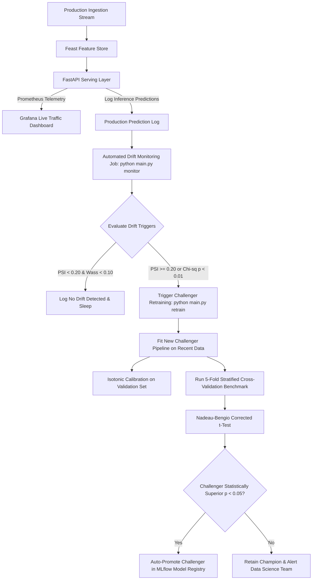

# Continuous Monitoring & Drift Remediation Guide

Comprehensive guide to production monitoring, drift detection, and automated champion-challenger retraining for the **Customer Churn MLOps Platform**.

---

## 1. Monitoring Philosophy: The Retraining Flywheel

In customer churn systems, **data drift is a leading indicator of business loss**. Once a company notices actual customer cancellations increasing in financial statements, model degradation has already been costing recurring revenue for 30–60 days.

This platform implements a closed-loop monitoring flywheel:



---

## 2. Drift Detection Methodologies

The monitoring engine in [`src/monitoring/drift_detector.py`](file:///home/deepak/customer-churn-mlops/src/monitoring/drift_detector.py) evaluates three statistical dimensions:

### A. Numerical Feature Drift: Population Stability Index (PSI)
Measures the divergence between the baseline training distribution ($P_{\text{ref}}$) and the current production stream ($P_{\text{curr}}$) across quantile-binned deciles:

$$\text{PSI} = \sum_{b=1}^{B} \left( P_{\text{curr}}(b) - P_{\text{ref}}(b) \right) \cdot \ln \left( \frac{P_{\text{curr}}(b)}{P_{\text{ref}}(b)} \right)$$

| PSI Score | Statistical Interpretation | Automated Action |
|---|---|---|
| $\text{PSI} < 0.10$ | Stable; no significant shift | Routine monitoring |
| $0.10 \le \text{PSI} < 0.20$ | Moderate shift in feature distributions | Warning flag logged; monitor closely |
| $\text{PSI} \ge 0.20$ | **Severe population drift** | **Automated retraining triggered** |

### B. Categorical Feature Drift: Chi-Squared Goodness-of-Fit Test
Tests whether observed frequency distributions of categorical attributes (e.g., `Contract`, `PaymentMethod`, `InternetService`) diverge from the reference expected frequencies:

$$\chi^2 = \sum_{k=1}^{K} \frac{(O_k - E_k)^2}{E_k}$$

- **Null Hypothesis ($H_0$)**: Production distribution matches training reference.
- **Trigger**: Categorical drift flagged when $p \le 0.01$ with large sample sizes.

### C. Prediction Probability Drift: Wasserstein Distance
Monitors shifts in the continuous distribution of model output probabilities ($p \in [0, 1]$):
$$W_1(u, v) = \int_{-\infty}^{+\infty} |U(x) - V(x)| dx$$
- Flags when the output distribution has shifted by $W \ge 0.10$, catching systemic macro-economic behavioral changes before ground-truth churn labels arrive.

---

## 3. Operational Usage & Commands

### Step 1: Snapshot Baseline Training Reference
After model training, save the baseline distribution snapshot:
```bash
poetry run python scripts/save_reference_data.py
# Generates:
# - data/reference/reference_features.parquet
# - data/reference/reference_probabilities.npy
# - data/reference/reference_metadata.json
```

### Step 2: Generate Drift Reports
Run the unified CLI monitor command:
```bash
# Compare production stream against saved reference snapshot
poetry run python main.py monitor

# Or compare a specific production batch file:
poetry run python main.py monitor --current data/raw/production_stream_june.csv --output results/metrics/drift_results.json
```

### Step 3: Inspect the Generated Drift Metrics (`results/metrics/drift_results.json`) & Report (`results/DRIFT_MONITORING_REPORT.md`)
```json
{
  "timestamp": "2026-10-10T11:00:00Z",
  "overall_drift_detected": true,
  "drifted_features": ["MonthlyCharges", "Contract"],
  "numerical_drift": [
    {
      "feature_name": "MonthlyCharges",
      "drift_score": 0.2412,
      "is_drifted": true,
      "method": "psi",
      "threshold": 0.20
    }
  ],
  "prediction_drift_score": 0.1142,
  "prediction_is_drifted": true
}
```

---

## 4. Automated Retraining & Hypothesis-Tested Promotion

When drift is detected, running the retraining pipeline executes the **champion-challenger tournament**:

```bash
# Execute automated drift-triggered retraining flow
poetry run python main.py retrain
```

### Why Naive CV Score Comparison is Dangerous
In traditional setups, if Challenger mean ROC-AUC is `0.852` and Champion is `0.850`, teams automatically promote the challenger. **This is fundamentally invalid.** Because cross-validation folds share 80% of training data across folds, the variance of the difference is underestimated, leading to high false-alarm promotion rates (promoting noise).

### The Nadeau-Bengio (2003) Correction
The retraining pipeline applies the corrected repeated cross-validation test:
$$\hat{\sigma}^2_{\text{corrected}} = \left( \frac{1}{K} + \frac{n_{\text{test}}}{n_{\text{train}}} \right) \cdot S^2$$
$$t_{\text{corrected}} = \frac{\bar{d}}{\sqrt{\hat{\sigma}^2_{\text{corrected}}}} \sim t_{K-1}$$

The challenger is promoted in MLflow Model Registry **only if**:
1. It passes all Pandera data validation and fairness audits.
2. The corrected hypothesis test proves the challenger is superior at $p < 0.05$.

### Forcing a Retraining Run
For manual maintenance or quarterly scheduled refresh:
```bash
poetry run python main.py retrain --force
```

---

## 5. Real-Time Observability (Prometheus & Grafana)

The serving engine exports live metrics at `GET /metrics`:

| Metric Name | Type | Description |
|---|---|---|
| `prediction_requests_total` | Counter | Total volume of requests labeled by endpoint (`/predict`, `/uplift/predict`) |
| `prediction_errors_total` | Counter | Volume of 4xx/5xx failures |
| `prediction_latency_seconds` | Histogram | Request latency distribution percentiles (p50, p95, p99) |
| `churn_prediction_probability` | Histogram | Distribution of predicted churn probabilities across 10 deciles |
| `uplift_requests_total` | Counter | Total volume of causal intervention scoring requests |

Access the pre-provisioned Grafana dashboards when running Docker Compose:
- **URL**: [`http://localhost:3000`](http://localhost:3000) (default credentials: `admin` / `admin`).
