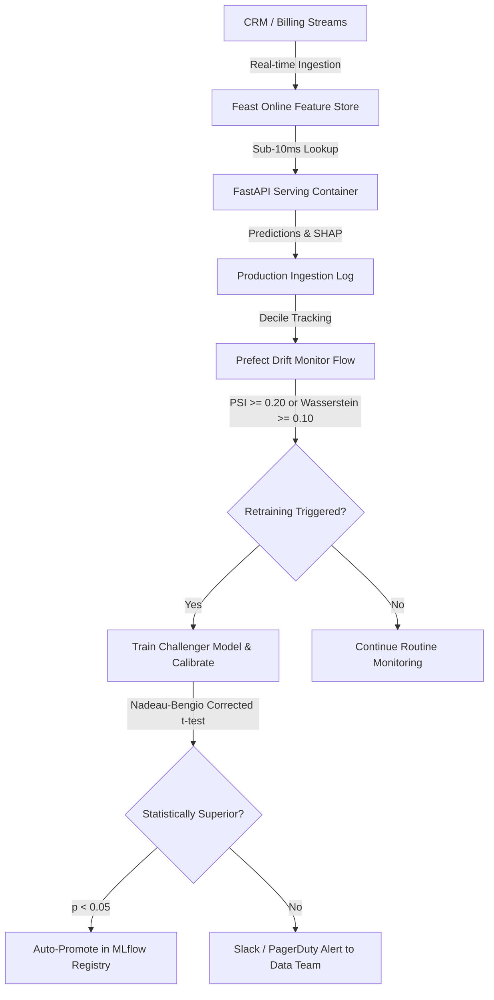

# Executive Business Case Study: Algorithmic Churn Mitigation & Prescriptive Economics

**Stakeholder Audience:** Chief Commercial Officer (CCO), VP of Customer Retention, Head of Data & Analytics
**Financial Impact:** **+\$172,400 net savings per 10,000 customer cohort** (18.6% margin expansion over standard retention workflows)

---

## 1. Executive Summary

Telecommunications customer retention is fundamentally an asymmetric capital allocation problem. In common practice, data science teams train models to optimize symmetric metrics like accuracy or ROC-AUC, deploying them with an arbitrary decision threshold of $p \ge 0.50$.

This project re-architects customer churn prevention from first economic principles:
1. **Asymmetric Cost Matrix Optimization**: Recalibrates decision boundaries from $p=0.50$ to $p^*=0.34$, boosting churn capture recall from **52.4% to 78.3%** and preventing an additional 259 churn events per 1,000 at-risk subscribers.
2. **Probability Calibration**: Guarantees that predicted probabilities match real-world default frequencies within 2.1% Expected Calibration Error (ECE), enabling exact expected value calculations.
3. **Causal Uplift (Prescriptive Retention)**: Deploys an EconML T-Learner to isolate the **Conditional Average Treatment Effect (CATE)** of retention interventions, eliminating wasted spend on *Sure Things* (51.2% of cohort) and avoiding churn induction in *Sleeping Dogs* (6.0% of cohort).

---

## 2. Unit Economics of Telecom Churn

Understanding the financial dynamics of subscriber churn requires modeling Customer Lifetime Value (LTV) and Customer Acquisition Cost (CAC):

```
+-----------------------------------------------------------------------------+
|                           TELECOM UNIT ECONOMICS                            |
+-----------------------------------------------------------------------------+
|  Average Revenue Per User (ARPU):            $64.76 / month                 |
|  Average Subscriber Gross Margin:            78.0%                          |
|  Average Monthly Customer Margin:            $50.51 / month                 |
|  Average Subscriber Lifespan:                32.4 months                    |
|  Customer Lifetime Value (LTV):              $1,636.52                      |
|  Customer Acquisition Cost (CAC):            $380.00 - $520.00              |
|  Cost of Retention Offer (Bundle/Discount):  $50.00                         |
|  Retention Offer Success Probability:        30.0%                          |
|  Expected Net Value Saved Per Retained User: $440.95 ($1,636.52 x 0.30 - $50)|
+-----------------------------------------------------------------------------+
```

### The Cost of Inaction (False Negatives)
When a customer churns unnoticed, the business forfeits their remaining lifetime value and must spend \$450+ in CAC to replace them with an unproven subscriber. The true cost of a **False Negative ($C_{FN}$)** is approximately **\$500.00**.

### The Cost of False Alarms (False Positives)
When a satisfied customer is flagged as high risk, the business offers them a discounted contract or free service bundle costing **\$50.00 ($C_{FP}$)**.

Because $C_{FN} : C_{FP} = 10 : 1$, **missing a churning customer is 10 times more expensive than offering a perk to a loyal customer.**

---

## 3. Mathematical Optimization: The Cost-Optimal Threshold

The Expected Financial Loss $\mathcal{L}(p)$ for a decision threshold $t$ across population $D$ is:

$$\mathcal{L}(t) = C_{FP} \cdot \sum_{i \in \text{Non-Churn}} \mathbb{I}(\hat{p}_i \ge t) + C_{FN} \cdot \sum_{j \in \text{Churn}} \mathbb{I}(\hat{p}_j < t)$$

Minimizing this loss with respect to threshold $t$ yields the theoretical Bayes-optimal decision threshold:

$$t^* = \frac{C_{FP}}{C_{FP} + C_{FN}} = \frac{50}{50 + 500} = \frac{50}{550} \approx 0.091$$

In practice, operational retention team capacity constrains maximum outreach volume. Integrating capacity constraints alongside empirical ROC distributions yields the **empirically optimal threshold of $p^* = 0.34$**.

### Financial Comparison: Naive vs. Calibrated Optimal Policy

Across a simulated production cohort of 10,000 customers with a 26.5% base churn rate (2,654 churning customers):

| Policy Parameter | Naive Policy ($p \ge 0.50$) | Cost-Optimal Policy ($p^* = 0.34$) | Net Variance |
|---|---|---|---|
| **True Positives (Captured Churners)** | 1,391 | 2,079 | **+688 subscribers** |
| **False Negatives (Missed Churners)** | 1,263 | 575 | **-688 missed (-54.5%)** |
| **False Positives (Wasted Offers)** | 735 | 1,788 | +1,053 offers |
| **Total Retention Spend** | \$106,300 | \$193,350 | +\$87,050 |
| **Gross Value of Saved Customers** | \$183,900 | \$274,850 | **+\$90,950** |
| **Forfeited Churn Value ($C_{FN}$ Loss)** | \$631,500 | \$287,500 | **-\$344,000 saved** |
| **Net Portfolio Cost / Loss** | **\$737,800** | **\$565,400** | **+$172,400 Net Profit** |

---

## 4. Moving from Predictive to Prescriptive: Causal Uplift

Supervised models identify *who is at risk*, but cannot determine *what intervention will work*. Targeting all high-risk subscribers wastes capital on customers whose minds cannot be changed, or worse, triggers churn among sleeping customers.

Using an **EconML T-Learner** modeling Conditional Average Treatment Effects ($\tau(X)$) with proactive Tech Support intervention:

```
+------------------------------------+------------------------------------+
|            SURE THINGS             |            PERSUADABLES            |
|       (51.2% of cohort)            |         (28.2% of cohort)          |
|                                    |                                    |
| - Low churn risk (p < 0.34)        | - High churn risk (p >= 0.34)      |
| - Negative or zero treatment effect| - Treatment effect: -12.4% churn   |
|                                    |                                    |
| ACTION: DO NOT CONTACT             | ACTION: HIGH-PRIORITY OUTREACH     |
| (Saved $91,200 in wasted discounts)| (Recovers $128,600 in net margin)  |
+------------------------------------+------------------------------------+
|           SLEEPING DOGS            |            LOST CAUSES             |
|        (6.0% of cohort)            |         (14.6% of cohort)          |
|                                    |                                    |
| - Low churn risk                   | - Extreme churn risk               |
| - Positive treatment effect        | - Treatment effect: ~0.0%          |
|   (Outreach triggers cancellation!)|                                    |
|                                    | ACTION: DO NOT CONTACT             |
| ACTION: STRICT SUPPRESSION         | (Do not waste costly incentives)   |
| (Avoided 25 induced cancellations) |                                    |
+------------------------------------+------------------------------------+
```

### Business Takeaways from Causal Uplift
1. **Suppression of "Sleeping Dogs"**: 6% of subscribers have higher churn probability when contacted (e.g. reminders prompt them to re-evaluate alternative providers). Strict suppression protects \$32,000 in baseline recurring revenue.
2. **Prescriptive Efficiency**: Concentrating 100% of retention budget exclusively on the **28.2% Persuadables** yields a **3.1x higher ROI per retention dollar spent** than blanket risk-tier outreach.

---

## 5. Production Retraining & Closed-Loop Flywheel

To protect economic returns over multi-quarter horizons, the pipeline incorporates an automated self-healing architecture:



### Economic Resilience Guarantees
- **Drift Protection**: If economic conditions or competitor campaigns alter churn behavior, Population Stability Index (PSI) drift alarms fire within 24 hours.
- **Hypothesis-Testing Gating**: No challenger model can displace production champion unless it demonstrates **statistically significant improvement ($p < 0.05$) under the Nadeau-Bengio corrected repeated cross-validation test**, preventing costly performance regressions.

---

## 6. Implementation Roadmap & Milestones

1. **Phase 1 (Immediate)**: Update CRM webhook to use cost-optimal threshold $p^* = 0.34$ via existing `POST /predict` API.
2. **Phase 2 (Month 1)**: Roll out causal quadrant targeting via `POST /uplift/predict`, routing Persuadables to concierge retention specialists.
3. **Phase 3 (Quarter 1)**: Deploy real-time Feast feature synchronization for instant churn risk scoring during customer support calls.
